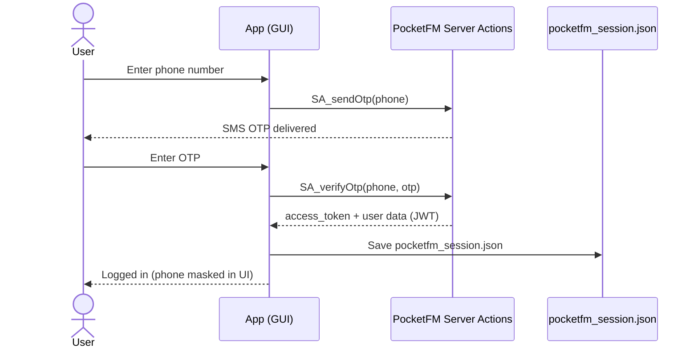
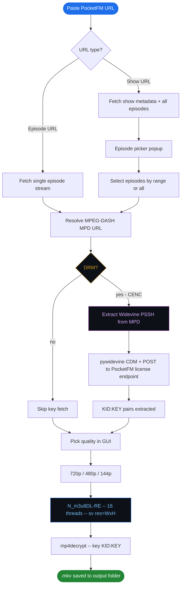
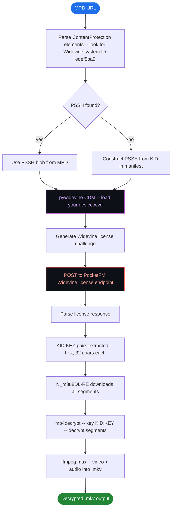
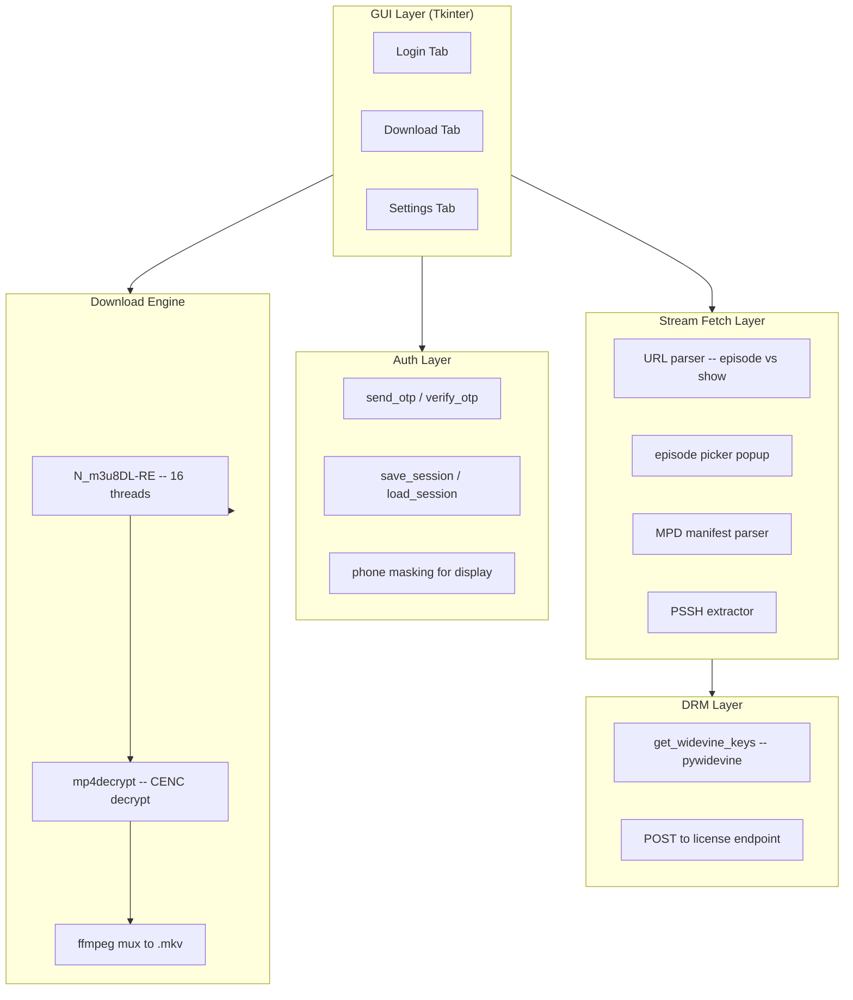

# 🎧 PocketFM Downloader

**A full-featured desktop GUI to download PocketFM shows and episodes with DRM support, multi-quality selection, and live progress tracking.**

[](https://python.org) [](.) [](LICENSE) [](.) [](.) [](https://github.com/nilaoda/N_m3u8DL-RE)

> **Personal and educational use only. Read the [Disclaimer](#disclaimer) before anything else.**

---

## Table of Contents

- [What is this?](#what-is-this)
- [Features](#features)
- [Requirements](#requirements)
- [Installation](#installation)
- [Usage](#usage)
- [Login Flow](#login-flow)
- [Download Flow](#download-flow)
- [DRM: Widevine and L3 CDM](#drm-widevine-and-l3-cdm)
- [Architecture](#architecture)
- [FAQ](#faq)
- [Disclaimer](#disclaimer)

---

## What is this?

**PocketFM Downloader** is an open-source Python desktop application for downloading content from [PocketFM](https://pocketfm.com), one of India's leading audio/video OTT platforms for shows, web series, and original content.

It reverse-engineers the PocketFM web client's Next.js Server Actions, stream fetch API, and Widevine DRM license flow. No browser extensions, no Chrome DevTools, no manual HAR exports.

**Why one file?** Intentional. No imports to chase, no `src/` folder maze. Clone it, run it, done.

---

## Features

- Phone OTP login, no password stored
- Session persistence: saved to `pocketfm_session.json`, auto-restored on next launch
- Paste any PocketFM episode or show URL to fetch stream info automatically
- Quality picker: 144p, 480p, 720p
- Full show downloader: pick episodes by range or select all / unfinished
- Widevine L3 key extraction using your own `.wvd` CDM device file
- CENC decryption via mp4decrypt (Bento4)
- 16-thread parallel download via N_m3u8DL-RE
- Real-time progress bar with speed (MB/s)
- Scrollable download log with Copy and Clear buttons
- Responsive GUI: auto-sizes to your screen on launch
- Phone number masking in UI for privacy
- Dark and clean, no terminal after setup

---

## Requirements

### Python

Python 3.8 or higher.

### Python packages

```bash
pip install requests pywidevine
```

### External tools

All three are **mandatory**. Download and set their paths in the **Settings tab** of the GUI before downloading anything.

| Tool | Purpose | Download |
| --- | --- | --- |
| **N_m3u8DL-RE** | MPEG-DASH segment downloader, 16-thread | [github.com/nilaoda/N_m3u8DL-RE](https://github.com/nilaoda/N_m3u8DL-RE/releases) |
| **mp4decrypt** | Widevine CENC decryptor | [bento4.com](https://www.bento4.com/downloads/) -- inside Bento4 SDK zip |
| **pywidevine + .wvd** | CDM key extraction | `pip install pywidevine` + your L3 `.wvd` device file |

> Set the full path to each binary in **Settings** inside the app.

### Widevine CDM (`.wvd` file)

Required for DRM-protected content. Without it the app still works for non-DRM streams. See the [DRM section](#drm-widevine-and-l3-cdm) for details.

---

## Installation

```bash
# 1. Clone
git clone https://github.com/arvind88765/pocketfm_downloader
cd pocketfm_downloader

# 2. Install Python dependencies
pip install requests pywidevine

# 3. Place N_m3u8DL-RE and mp4decrypt in the folder or add to PATH

# 4. Run
python pocketfm_downloader.py
```

---

## Usage

**Login tab**

1. Enter your phone number (10 digits, India).
2. Click Send OTP. Enter the OTP from SMS.
3. Click Verify and Login. Session saved automatically to `pocketfm_session.json`.

**Download tab**

1. Paste a PocketFM episode or show URL.
2. Click **Fetch Qualities** to pull stream info.
3. For a show URL, pick episodes from the popup (by range or Select All / Unfinished).
4. Select quality (720p / 480p / 144p).
5. Click **Download**.

**Settings tab**: Set paths to N_m3u8DL-RE, mp4decrypt, your `.wvd` CDM file, and output folder here. Save before first download.

---

## Login Flow

PocketFM uses phone OTP via its Next.js backend Server Actions over HTTPS. Session saved as `pocketfm_session.json`.



**Session details:**

- Token saved to `pocketfm_session.json` in the app directory
- App auto-restores the session on next launch, no re-login needed until expiry
- Phone number is masked in the GUI (e.g. `+91xxxxxxx89`) -- raw value never displayed

---

## Download Flow



---

## DRM: Widevine and L3 CDM

### What is DRM?

PocketFM protects its video content with **Widevine CENC DRM**. Encrypted streams cannot be saved without obtaining decryption keys from the PocketFM license server.

### Key extraction flow



### L3 CDM is required for DRM content

> **You must supply your own Widevine L3 CDM device file (`.wvd`) to download DRM-protected content.**

A CDM (Content Decryption Module) is a device-specific Widevine implementation. L3 is the software-level CDM. PocketFM streams are protected at L3 level, so a software CDM is sufficient.

**The `.wvd` file is not provided.** You must extract it from an Android device or emulator you own.

Guide: [Dumping Your Own L3 CDM with Android Studio](https://forum.videohelp.com/threads/408031-Dumping-Your-own-L3-CDM-with-Android-Studio)

Once you have the file:

1. Open the app, go to Settings.
2. Set the WVD Device File path.
3. Save.

---

## Architecture



---

## Output

Files are saved to `Downloads/PocketFM/` by default.

```
Downloads/
└── PocketFM/
    ├── Ep.1.-.Title.720p.mkv
    ├── Ep.2.-.Title.480p.mkv
    └── ...
```

---

## FAQ

**Q: Does this work with a free PocketFM account?**
Downloads whatever your account has access to. Locked content requires a paid plan.

**Q: "No PSSH found" in log. DRM content not downloading?**
Make sure you have set a valid `.wvd` CDM file in Settings. Without it, Widevine key extraction will not run.

**Q: Where do I get a `.wvd` CDM file?**
Not provided here. Extract it from an Android device or emulator you own. See this guide: [Dumping Your Own L3 CDM with Android Studio](https://forum.videohelp.com/threads/408031-Dumping-Your-own-L3-CDM-with-Android-Studio)

**Q: N_m3u8DL-RE says the file already exists?**
Delete the existing `.mkv` in your output folder. N_m3u8DL-RE does not overwrite existing files.

**Q: Session expires every restart?**
The app auto-restores from `pocketfm_session.json`. If expired, log in again via the Login tab.

**Q: Can I download a full show at once?**
Yes. Paste the show URL, hit Fetch Qualities, and use the episode picker to select by range or grab all / unfinished episodes at once.

**Q: Which qualities are available?**
720p, 480p, and 144p. PocketFM serves square-format streams (720x720, 480x480, 144x144) for video shows.

---

## Notes

- Session is stored in plain text at `pocketfm_session.json`. Keep this file private.
- The `.wvd` CDM file is sensitive. Do not share it.
- Downloads are saved as `.mkv` containers by default.
- DRM keys are content-specific. They are only valid during your active download session.

---

## Disclaimer

This tool is for personal and educational use only.

- You need an active PocketFM account to use this.
- Downloading DRM-protected content may violate PocketFM's Terms of Service.
- Do not distribute anything you download.
- The `.wvd` Widevine device file is not provided and must be sourced by you.
- This project is not affiliated with or endorsed by PocketFM or its parent company.
- The authors take no responsibility for how this tool is used.

---

**Keywords:** `pocketfm downloader` `download pocketfm shows` `pocketfm drm downloader` `pocketfm python gui` `widevine l3 drm downloader` `N_m3u8DL-RE pocketfm` `pywidevine pocketfm` `MPEG-DASH downloader python` `pocketfm stream download` `pocketfm episode downloader` `indian ott downloader` `pocketfm offline`
